# 逻辑运算符与流程控制

> 日期：2026-10-19 ｜ 更新：2026-10-20 ｜ 标签：#基础语法 #运算符 #流程控制 #switch #循环

## 逻辑运算符

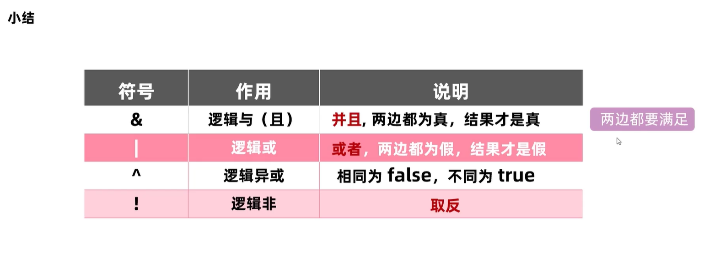

## 短路逻辑运算符

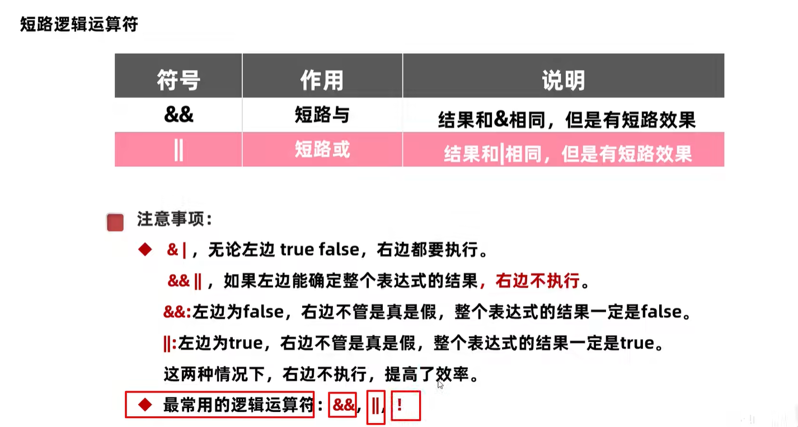

## 三元运算符

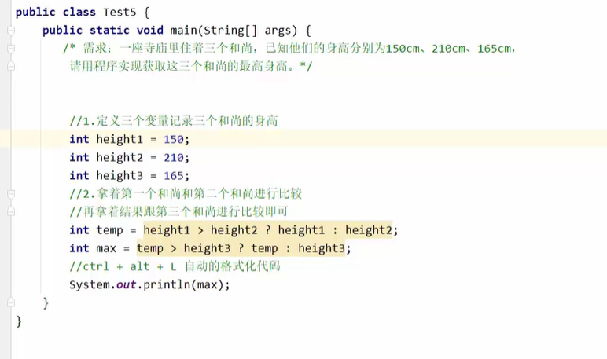

格式化代码记得学习一下

## 流程控制语句

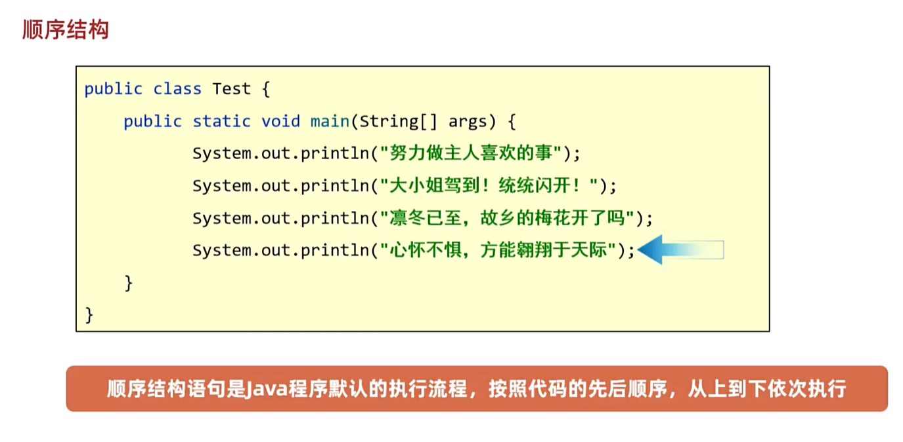

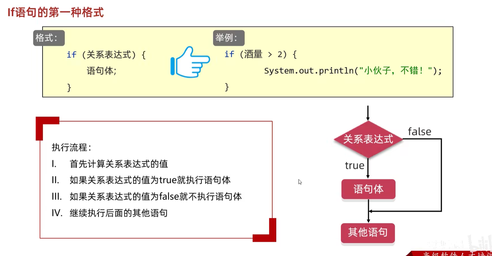

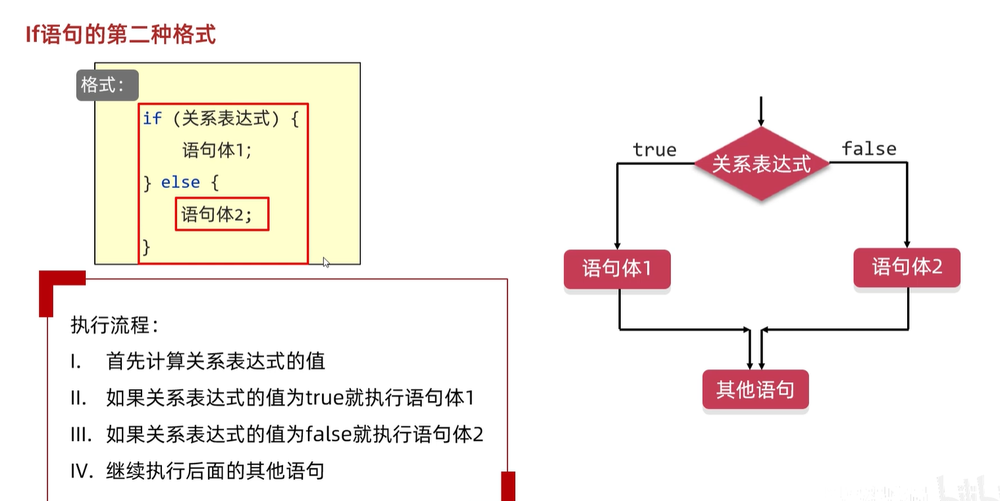

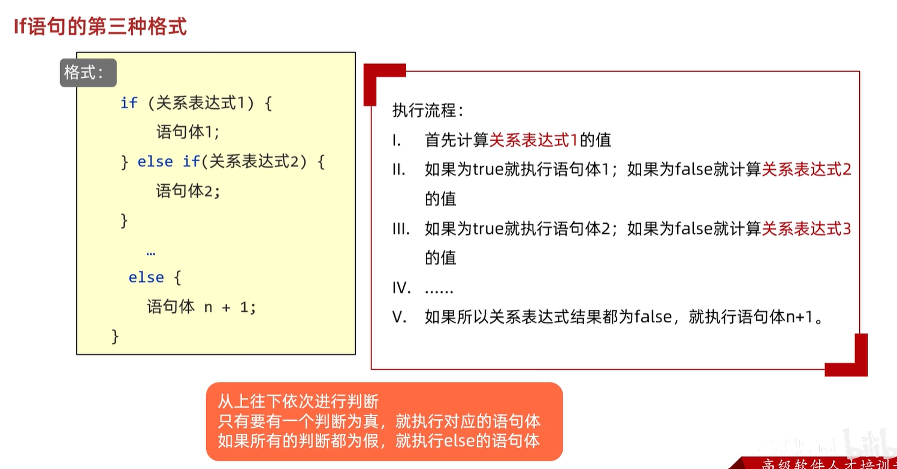

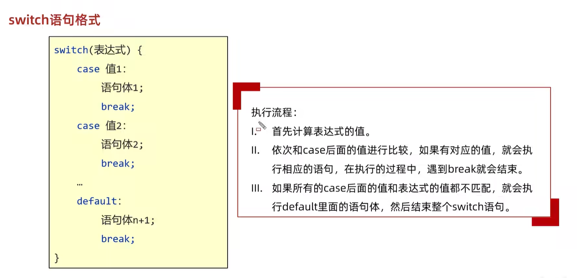

### default 的用法

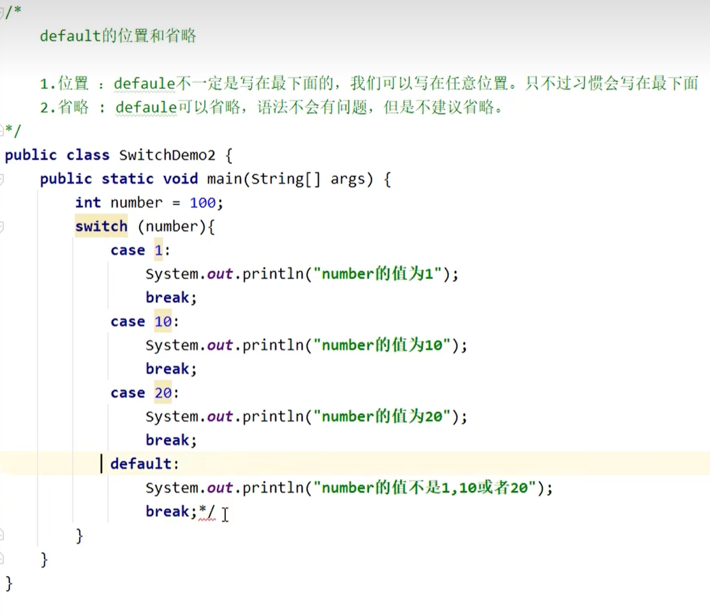

### case 穿透

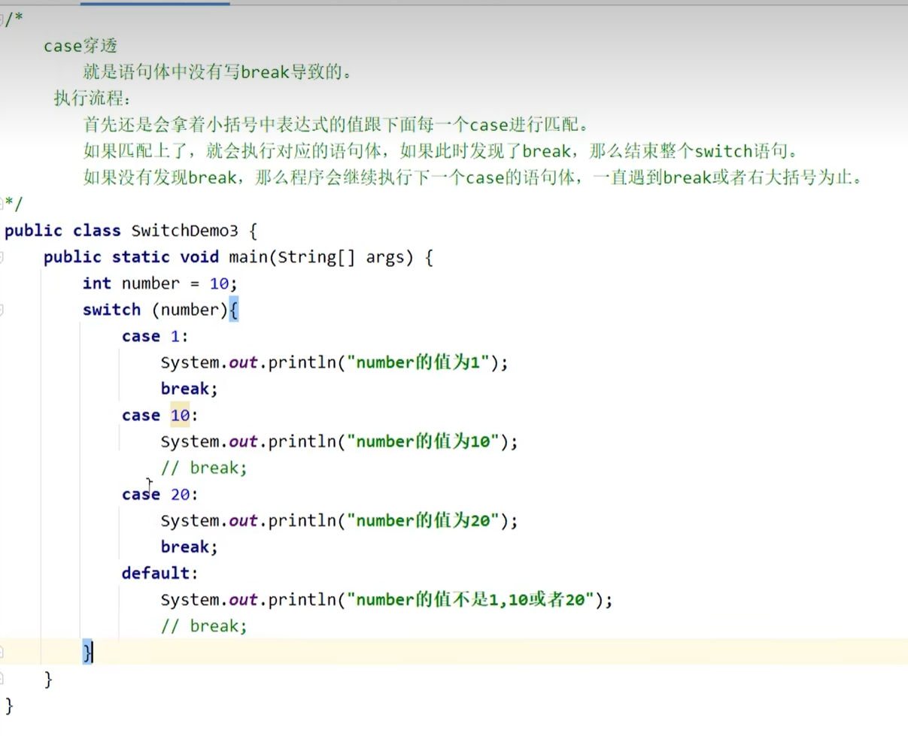

### switch 的新特性

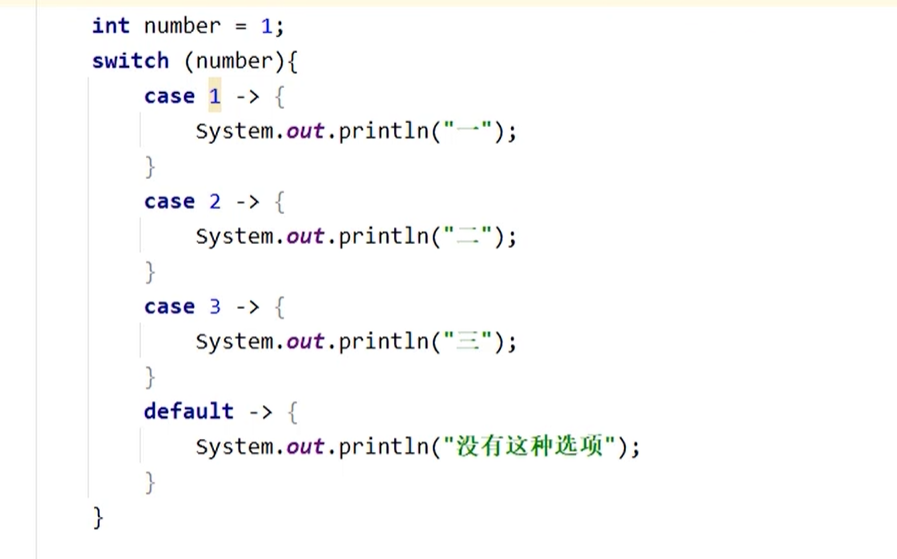

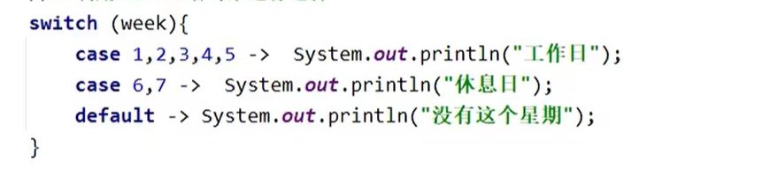

省略了break并且可以避免case穿透

### switch 和 if 分别的应用场景

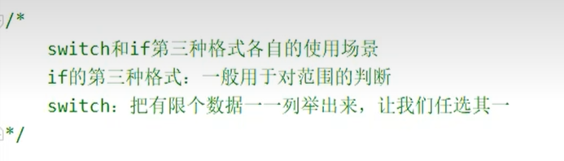

## 键盘录入

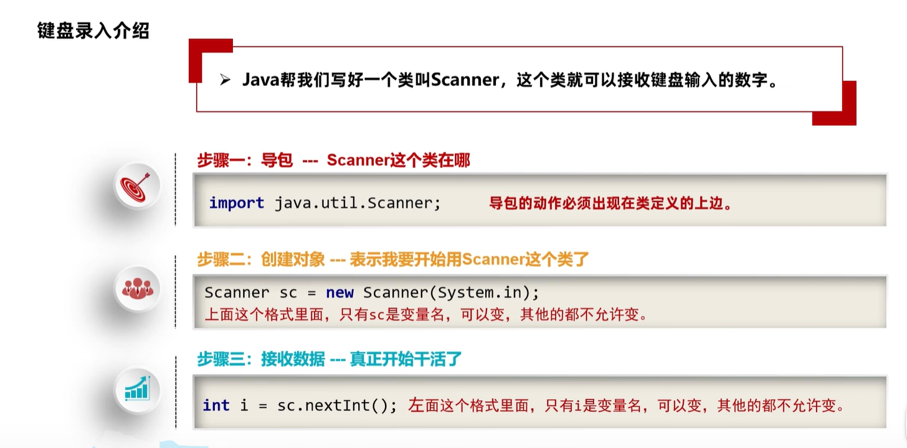

这个只可以用来读取数字，把int去掉就可以识别文字了

## 循环结构

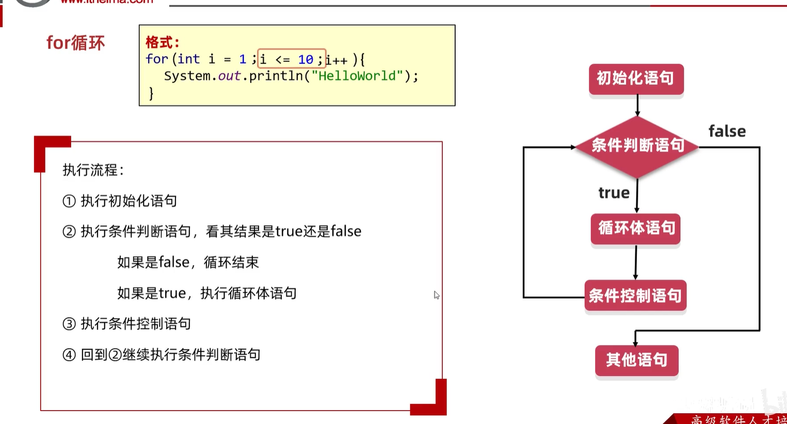

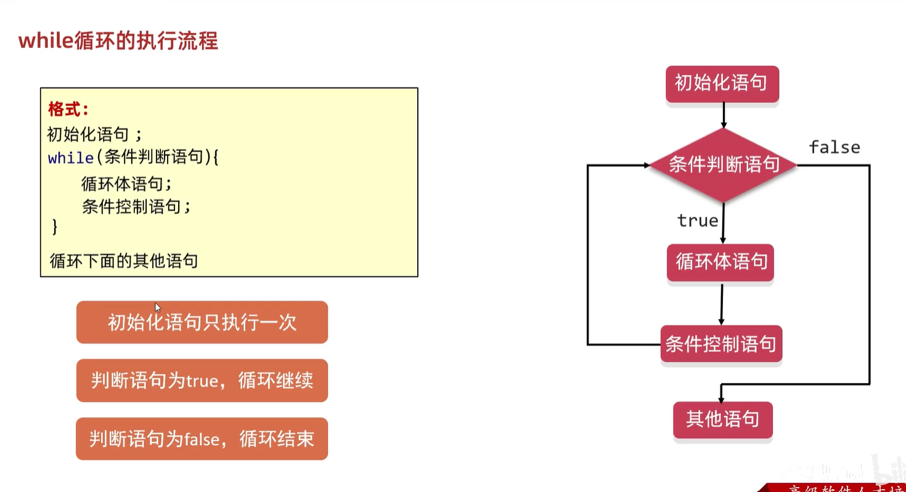

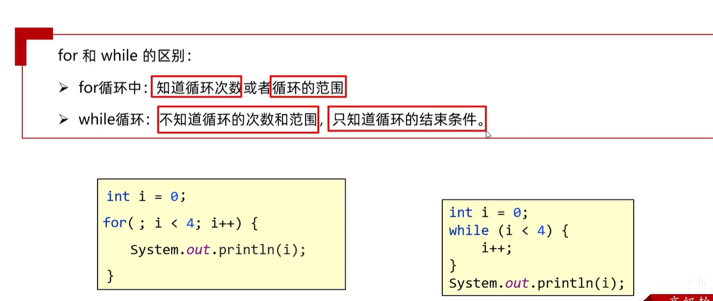

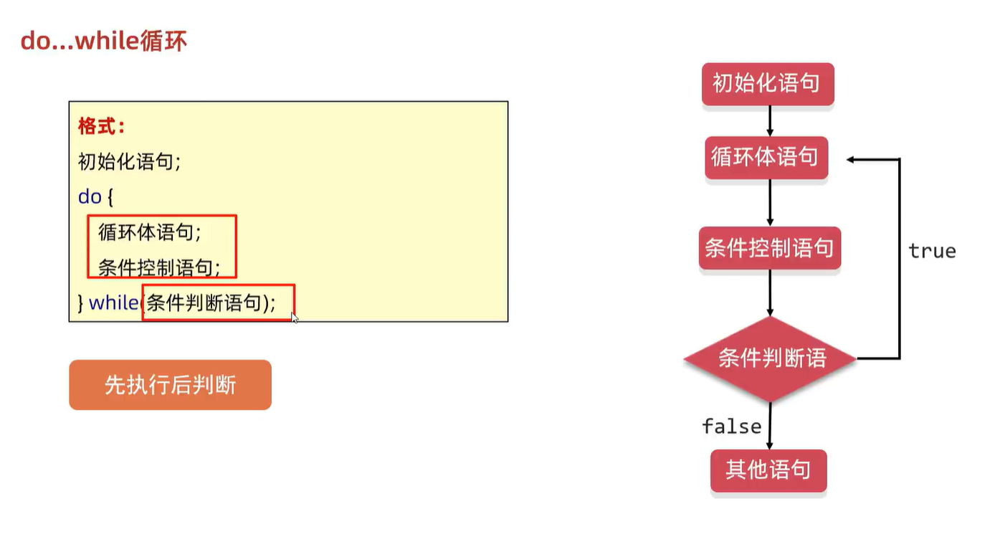